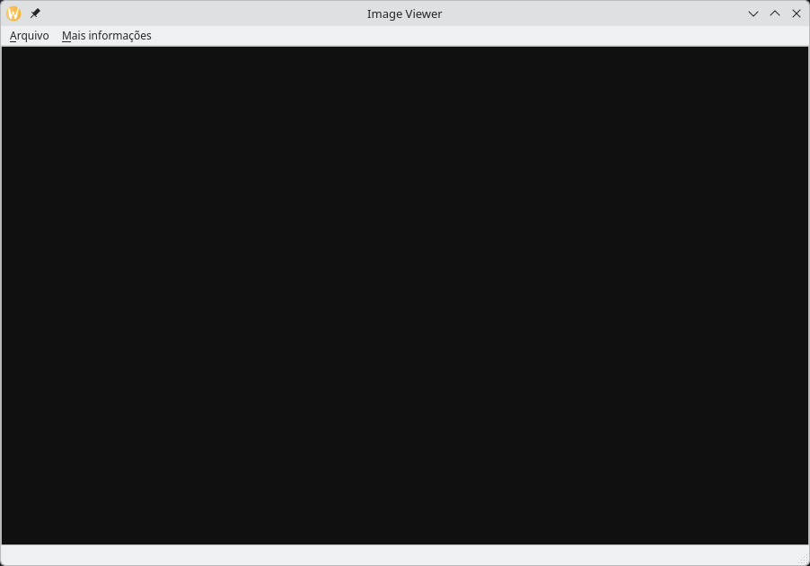
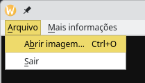
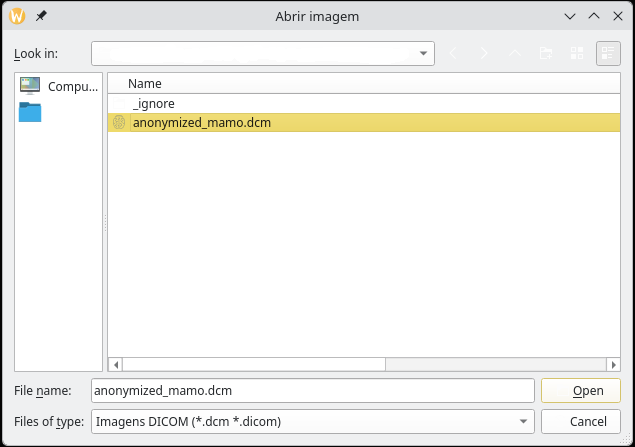
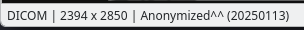
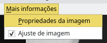
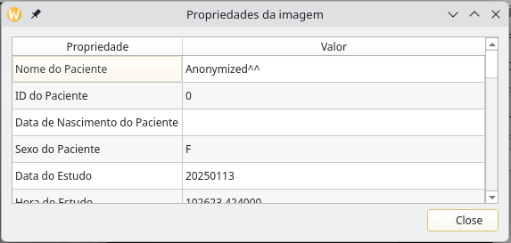
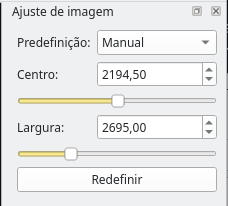
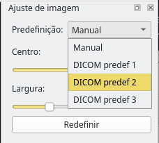
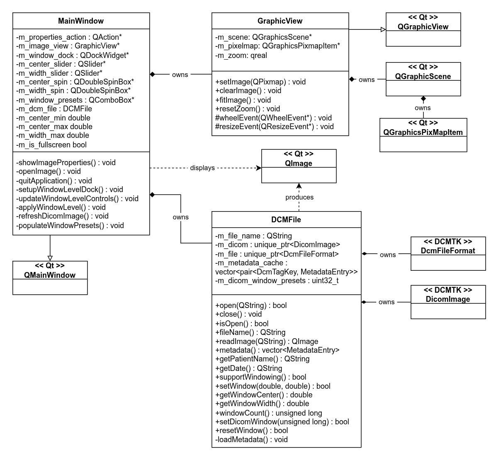

# DICOM Viewer Qt6

[](https://github.com/Lohkdesgds/DICOM-Viewer-Qt6/actions/workflows/build.yaml)

DICOM Viewer Qt6 é um projeto multiplataforma feito em [Qt6](https://wiki.qt.io/About_Qt) (6.12.0) para abrir imagens DICOM (.dcm) usando a biblioteca [DCMTK](https://github.com/DCMTK/dcmtk).

O projeto consiste em uma janela gerenciada por uma classe derivada da `QMainWindow`, na qual foi utilizada `QGraphicsView` como base para manipulação da imagem, incluindo automaticamente recursos comuns de um aplicativo de galeria (zoom, arrastar a imagem, scroll). Na janela principal foi adicionada também uma _dock_ com `QSlider`s e outros objetos para ajustes finos de imagens monocromáticas (width / center), incluindo predefinições, quando disponibilizadas pelo arquivo.

Junto a estas ferramentas do `Qt`, foi desenvolvida a classe `DCMFile`, que carrega as imagens do tipo `DICOM` (`.dcm`) usando internamente objetos da biblioteca `DCMTK` e transforma seus dados em uma imagem interpretável pelo `Qt` (`QImage`). Junto a isso, é feita a leitura dos metadados do arquivo, usando uma tabela predefinida para as chaves, usada posteriormente para mostrar informações do arquivo pelo aplicativo.


# Como utilizar o programa

## Baixando o executável

A maneira mais direta é baixando das [releases](https://github.com/Lohkdesgds/DICOM-Viewer-Qt6/releases) o arquivo correspondente a seu sistema operacional.

Após extrair, a estrutura de arquivos deve se assemelhar a isto:

```
App
├─ 📁 bin
│  └─ 📦 DICOM-Viewer-Qt6
├─ 📁 lib
│  └─ ...
└─ ...
```

O foco para executar está na pasta `bin/`, onde você deve encontrar o executável dentro (`DICOM-Viewer-Qt6` ou `DICOM-Viewer-Qt6.exe`).

No macOS, o formato segue o seguinte:

```
App
├─ 📁 DICOM-Viewer-Qt6.app
│  └─ 📁 Contents
│    └─ 📁 macOS
│      └─ 📦 DICOM-Viewer-Qt6
├─ 📁 lib
│  └─ ...
└─ ...
```

Só o lugar do executável é outro, mas o resto deve ser semelhante.

> [!NOTE]
> 
> Se for copiar ou mover o executável para outro lugar, é melhor copiar todos os arquivos, incluindo as pastas dentro do zip.
> Dentro das outras pastas estão as dependências do aplicativo. Sem elas, ele pode não abrir.

## Interface do aplicativo

O aplicativo foi desenvolvido focando primariamente em abrir e visualizar imagens `DICOM`, com alguns menus para facilitar na obtenção de informações do arquivo e ajustes finos.

Ao abrir o aplicativo, você encontrará esta tela:



Nela existem dois menus, `Arquivo` e `Mais informações`. Para abrir uma imagem, use `Arquivo > Abrir imagem...`



Você encontrará uma interface para navegar pelos arquivos do seu computador. Encontre o arquivo desejado e clique em abrir:



A imagem será exibida ajustada ao espaço da janela do aplicativo. 

Com a imagem aberta, você pode usar o scroll do mouse para aplicar zoom e arrastar para mover a imagem de um lado para o outro, atalhos comumente encontrados em aplicativos do tipo.

Outro fato é que embaixo na esquerda é possível verificar algumas informações: tipo da imagem, resolução, paciente e data.



Agora, uma vez carregada a imagem, você pode visualizar as informações do arquivo usando o menu de `Mais informações > Propriedades da imagem`:





Se a imagem for do tipo monocromática, é possível ajustar o contraste (width / center) com o menu `Mais informações > Ajuste de imagem`. Esta _dock_ abre automaticamente quando o programa detecta uma imagem monocromática, então, se quiser ocultar a _dock_, você pode usar o mesmo menu.

A _dock_ tem algumas opções de ajuste:



Os ajustes são:
- `Predefinição`: caso o arquivo tenha predefinições, elas aparecerão listadas neste menu
- `Centro`: ajuste fino do centro (center) com uma barra ou campo para digitar um valor
- `Largura`: ajuste fino da largura (width) com uma barra ou campo para digitar um valor

Exemplo de predefinições:




# Como compilar

Existe uma [pipeline](https://github.com/Lohkdesgds/DICOM-Viewer-Qt6/actions/workflows/build.yaml) automatizada que já compila para as 3 plataformas, instalando as bibliotecas necessárias automaticamente e subindo os arquivos para a aba de [releases](https://github.com/Lohkdesgds/DICOM-Viewer-Qt6/releases).

Caso queira compilar por conta própria, siga as etapas abaixo:

## Dependências

O projeto espera que você tenha instalado no seu computador:
- Python (por exemplo 3.14)
- CMake (pelo menos 3.25)
- Compilador C/C++ (depende de plataforma)

Para **Linux**, talvez você tenha que instalar estes pacotes (lista baseada em Debian/Ubuntu):
```
    libgl1-mesa-dev
    libglu1-mesa-dev
    libopengl-dev
    libxkbcommon-dev
    libxkbcommon-x11-dev
```

> [!NOTE]
>
> Para **Windows**, recomendo que instale o Visual Studio (para vir com ele o MSVC, compilador da Microsoft para C/C++). Talvez você tenha que manualmente selecionar nos menus do Visual Studio para instalar o necessário para desenvolvimento C++.

> [!NOTE]
>
> No **Windows**, recomendo que use **`Git Bash`** como terminal. Ele simula comandos no formato que tanto o Linux quanto o macOS usam.

## Download do Qt6 na versão correta

Dado que seu Python esteja configurado e suas dependências também, você poderá fazer o download automático da versão do Qt6 usada no projeto com o script de apoio feito em Python (execute na raiz do projeto no terminal):

```
python3 scripts/install_qt.py
```

Este script deve detectar corretamente a sua plataforma, instalar o pacote Python `aqtinstall` e usar isso para baixar o Qt6 em `.qt` na pasta do projeto.

## Compilando o projeto

Seguindo com Python, toda a parte de variáveis do CMake e propriedades para compilar uma Release foram definidas no script `release.py`. Você pode compilar, então, usando:

```
python3 scripts/release.py
```

Por baixo dos panos, o script compila e cria uma release por install. A parte de compilar é basicamente isso:

```
cmake \
    -S . -B <BUILD_DIR> \
    -DCMAKE_BUILD_TYPE=Release \
    -DCMAKE_INSTALL_PREFIX=<DIST_DIR> \
    -DQt6_ROOT=<QT_ROOT> \
    -DQt6_DIR=<QT_CMAKE> \
    -DCMAKE_PREFIX_PATH=<QT_ROOT>
```

Onde:
- `BUILD_DIR`: caminho inteiro onde compilar o projeto (resulta em `$PWD/build/release`)
- `DIST_DIR`: caminho inteiro onde compilar a release (resulta em `$PWD/dist`)
- `QT_ROOT`: caminho raiz do Qt6 instalado, incluindo versão e tipo (por exemplo: `$PWD/.qt/6.12.0/gcc_64`)
- `QT_CMAKE`: o `QT_ROOT` acompanhado de `/lib/cmake/Qt6`


# Arquitetura do projeto

O projeto foi desenvolvido usando [DCMTK](https://github.com/DCMTK/dcmtk) e [Qt6](https://wiki.qt.io/About_Qt). DCMTK é a biblioteca responsável por abrir e interpretar arquivos `.dcm` (DICOM), enquanto o Qt6 gerencia eventos, janelas, entre outros.

A estrutura de arquivos segue o modelo:

```
DICOM Viewer Qt6
├─ 📁 .github
│  └─ 📁 workflows
│    └─ 📃 build.yaml
├─ 📁 cmake
│  └─ ⚙️ installDCMTK.cmake
├─ 📁 scripts
│  └─ 🐍 install_qt.py
│  └─ 🐍 release.py
├─ 📁 diagrams
│  └─ ...
├─ 📁 include
│  └─ ...
├─ 📁 src
│  └─ ...
└─ ⚙️ CMakeLists.txt
```

- `.github/workflows/build.yaml`: Contém o script automatizado de release que permite ser executado manualmente ou automaticamente ao criar uma tag no formato `v*`. Compila pra todos os 3 principais sistemas operacionais.
- `cmake/installDCMTK.cmake`: Script para o CMake baixar, configurar e compilar corretamente `DCMTK` como uma biblioteca do projeto.
- `scripts/`: Scripts Python para facilitar o download e instalação do Qt6 em qualquer sistema operacional, incluindo a compilação completa do projeto.
- `diagrams/`: Diagramas do projeto.
- `include/`: Arquivos `header` das classes utilizadas pelo aplicativo.
- `src/`: Arquivos `source` (fonte) com o código da aplicação.
- `CMakeLists.txt`: O projeto em si, feito com CMake, onde configura quais arquivos compilar, como integrar bibliotecas, e como criar a release final usando `install`.

# Diagrama de classes



# Possíveis problemas (e soluções)

## 1. Script do Python falhou ao baixar / não identificou corretamente o que baixar

Primeiro, verifique se você tem um ambiente virtual (`venv`). Depois, tente instalar manualmente `aqtinstall`. Se algum desses dois falhar, o problema pode ser com a própria instalação do Python. Se porventura não for isso, pode ser que a própria ferramenta de instalação `aqt` esteja quebrada. Em ambos os casos, a investigação exige uma análise passo a passo, tentando replicar o que já dá certo na pipeline automatizada.

## 2. No macOS não está abrindo / funcionando corretamente

Infelizmente eu não tenho um MacBook para testar, então a versão para macOS foi criada por documentação. Futuramente, com um dispositivo para avaliar e verificar possíveis erros, é possível fazer o aplicativo funcionar no macOS.

Eu não tenho nem como consertar um problema, caso apareça, devido à falta de dispositivo para validação, então infelizmente não tenho como garantir se funciona, ou se continuará funcionando no futuro.

## 3. Erros em chamadas no Python

Dependendo de como estiver a sua configuração do terminal, é possível que alguns executáveis que o Python utiliza (por exemplo, `cmake`) não estejam corretamente definidos no seu PATH. Se houver erros de chamada, verifique primeiro se seu PATH está apontando para todos os caminhos necessários, ou se todas as dependências estão instaladas.